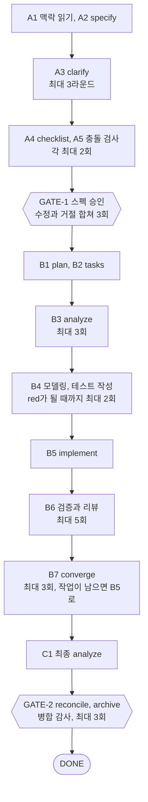
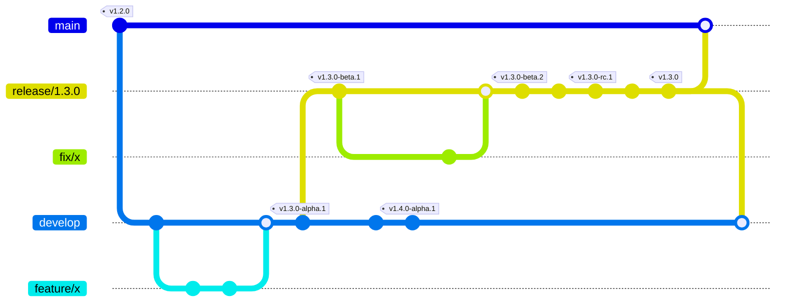
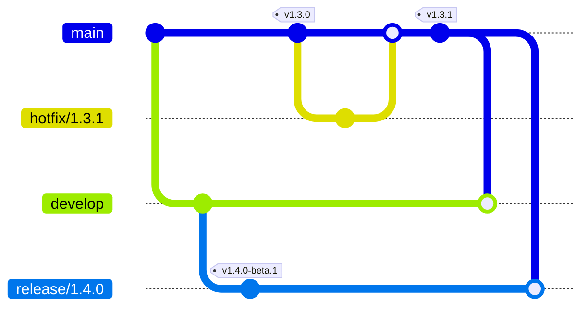

# Namaste World

Tauri 2 + React + TypeScript + Vite 데스크톱 앱.

## 요구 사항

- Node.js **24.21.0+** (`.nvmrc` 참고)
- pnpm **10** — 프로젝트에 버전이 고정되어 있으므로 corepack 사용을 권장합니다.
- Rust **stable** ([rustup](https://rustup.rs/)으로 설치, `rustup update stable`로 갱신)
- OS별 준비물: [Tauri 사전 요구 사항](https://v2.tauri.app/start/prerequisites/)
  - macOS: Xcode Command Line Tools
  - Windows: Microsoft C++ Build Tools, WebView2(Windows 10 이상은 기본 설치)

```bash
corepack enable
```

## 시작하기

```bash
pnpm install
pnpm dev
```

첫 실행은 Rust 의존성을 컴파일하느라 몇 분 걸립니다. 그다음부터는 바뀐 부분만 다시 빌드합니다.

## 스크립트

| 스크립트                         | 설명                                                        |
| -------------------------------- | ----------------------------------------------------------- |
| `pnpm dev`                       | 개발 모드 (renderer HMR, Rust 변경 시 다시 빌드하고 재시작) |
| `pnpm build`                     | 타입체크 후 renderer 빌드 (`out/renderer`)                  |
| `pnpm build:mac`                 | macOS dmg 패키징 (지금 Mac의 아키텍처)                      |
| `pnpm build:win`                 | Windows nsis 설치 파일 (x64)                                |
| `pnpm build:win:arm64`           | Windows ARM 설치 파일                                       |
| `pnpm build:unpack`              | 설치 파일 없이 실행 파일만 빌드 (빠른 확인용)               |
| `pnpm lint` / `format`           | ESLint / Prettier                                           |
| `pnpm lint:rust` / `format:rust` | Clippy / rustfmt                                            |
| `pnpm typecheck`                 | `vite.config.ts`(node)와 renderer(web) 각각 타입체크        |

결과물은 `src-tauri/target/release/bundle/`(다른 target을 지정하면 `src-tauri/target/<target>/release/bundle/`)에 생성됩니다.

## 구조

```
src/
  renderer/          React 앱
    src/api/         Rust 명령을 invoke로 감싼 함수 모음
src-tauri/
  src/lib.rs         앱 진입점. Builder 조립
  src/commands/      Rust 명령(#[tauri::command])
  capabilities/      renderer에 허용할 권한
  icons/             앱 아이콘 (pnpm tauri icon <png>로 다시 생성)
  tauri.conf.json    창, 보안(CSP), 번들 설정
vite.config.ts
```

- renderer는 OS에 직접 접근할 수 없습니다. 필요한 기능은 `src-tauri/src/commands/`에 명령으로 만들고 `src/renderer/src/api/`의 `api`에 추가하세요. 플러그인을 쓰면 그 창의 capability 파일(`capabilities/main.json` 등)에 권한을 추가해야 합니다.
- 앱 버전은 `package.json`의 `version`을 그대로 씁니다. `src-tauri/Cargo.toml`의 버전은 `0.0.0`으로 고정되어 있습니다.

## 디버깅

- renderer: 개발 모드에서 창을 우클릭해 **Inspect**를 고르거나, macOS는 `Cmd+Option+I`, Windows는 `Ctrl+Shift+I`로 DevTools를 엽니다.
- Rust: `println!` 출력은 `pnpm dev`를 실행한 터미널에 나옵니다. 중단점이 필요하면 VS Code에 CodeLLDB 확장을 설치해 붙입니다.

## 포맷팅 / 커밋 규칙

- 저장 시 Prettier 포맷 + ESLint 자동 수정 (`.vscode/settings.json`)
  — 추천 확장(Prettier, ESLint, EditorConfig, Tauri, rust-analyzer)을 설치하세요.
- 커밋 시 husky + lint-staged가 변경된 파일에 ESLint, Prettier, rustfmt를 적용합니다.
- 줄바꿈은 OS와 무관하게 **LF**로 통일됩니다 (`.gitattributes`, `.editorconfig`, Prettier `endOfLine`).

### Windows 개발 시

- 클론하기 전에 아래 설정을 권장합니다. `.gitattributes`가 LF를 강제하지만, 전역 설정까지 맞춰두면 안전합니다.

  ```bash
  git config --global core.autocrlf false
  ```

- husky 훅은 Git for Windows에 포함된 sh로 실행됩니다. GUI Git 클라이언트를 쓴다면 `pnpm`이 PATH에 있어야 합니다.

## spec-kit으로 기능 만들기

기능은 [spec-kit](https://github.com/github/spec-kit)으로 만듭니다. 스펙 작성부터 구현, 검증, 기존 스펙과의 병합까지를 autopilot 루프 하나로 돌립니다. 사람은 세 곳에서만 개입합니다. clarify 질문에 답하고, 스펙을 승인하고(GATE-1), 마지막에 병합을 확인합니다(GATE-2).

### 처음 설정

```bash
scripts/speckit-setup.sh
```

- `uv`, `jq`, 그리고 Claude Code(`claude`)나 Codex(`codex`) CLI 중 하나 이상이 필요합니다.
- spec-kit 설정(`.specify/`, 스킬, preset, 확장, workflow)은 저장소에 커밋되어 있습니다. 이 스크립트는 `specify-cli`를 고정 버전으로 설치하고 설정이 맞는지 점검합니다.
- spec-kit이나 확장 버전을 올릴 때는 `--rebuild`로 다시 설치합니다.
- 루프 없이 `/speckit-*` 명령을 직접 쓰려면 스크립트가 마지막에 알려 주는 `SPECKIT_PYTHON_EXECUTABLE`을 셸 설정에 넣습니다. spec-kit 스크립트가 preset 템플릿을 고를 때 PyYAML이 있는 파이썬이 필요합니다.

### 기능 하나 만들기

```bash
git switch -c feature/tray-version
scripts/speckit-run.sh \
  --spec "트레이 메뉴에 앱 버전을 보여 준다. 사용자가 지금 쓰는 버전을 바로 확인할 수 있게 한다." \
  --plan "버전은 package.json 값을 Rust에서 읽어 트레이 메뉴 맨 아래 비활성 항목으로 넣는다."
```

| 옵션                                        | 넘어가는 곳                                        | 필수                                                  |
| ------------------------------------------- | -------------------------------------------------- | ----------------------------------------------------- |
| `--spec "<설명>"` 또는 `--spec-file <경로>` | specify. 무엇을, 왜 만드는지. 여러 줄도 됩니다     | 둘 중 하나                                            |
| `--plan "<설명>"` 또는 `--plan-file <경로>` | plan. 기술 방향                                    | 아니요. 생략하면 plan 단계가 정합니다                 |
| `--maker claude\|codex`                     | 만드는 쪽(specify, plan, tasks, implement, 수정)   | 아니요. 기본 `claude`                                 |
| `--checker claude\|codex`                   | 검사하는 쪽(충돌 검사, analyze, 테스트 작성, 리뷰) | 아니요. 기본은 maker가 아닌 쪽, 그 CLI가 없으면 maker |

시작 조건은 `feature/*` 브랜치, 깨끗한 작업 트리입니다.

### 실행 중 사람이 할 일

| 시점    | 화면                              | 할 일                                                                                                                                                                                   |
| ------- | --------------------------------- | --------------------------------------------------------------------------------------------------------------------------------------------------------------------------------------- |
| clarify | `specs/<기능>/clarify/round-N.md` | 질문마다 `**답**:` 뒤에 답을 적고 `answered`를 고릅니다. 비워 둔 질문은 넘어갑니다. 최대 3라운드입니다                                                                                  |
| GATE-1  | `specs/<기능>/loop/gate1.md`      | `approve`는 승인, `edit`는 `spec.md`를 직접 고친 뒤 다시 검사, `reject`는 `loop/gate1-feedback.md`에 고칠 점을 적은 뒤 에이전트가 고치게 합니다. `edit`와 `reject`는 합쳐 3번까지입니다 |
| GATE-2  | 터미널 안내                       | 자기 에이전트에서 `/speckit-reconcile-run specs/<기능>`과 `/speckit-archive-run specs/<기능>`을 대화형으로 실행하고(Codex는 `$speckit-...`), 질문에 답한 뒤 `done`을 고릅니다           |

archive는 기존 요구사항을 지우거나 바꿀 때 대화 중에 확인을 받습니다. 그래서 루프가 대신 실행하지 않고 사람이 GATE-2에서 직접 실행합니다.

터미널이 아닌 곳에서 실행하면 gate에서 멈춥니다. 답을 정한 뒤 이어서 실행합니다.

```bash
scripts/speckit-run.sh --resume <run_id> --gate1 approve
```

### 흐름 한눈에 보기



- 모든 루프에 상한이 있습니다. 최악의 경우 에이전트 호출은 73번입니다(테스트 작성 서브에이전트 제외).
- 고쳐도 아무것도 바뀌지 않거나(진전 없음), 실패가 늘어나거나(퇴행), 구현 쪽이 테스트를 고치면(테스트 변조) 상한 전에 멈춥니다.
- 테스트는 구현과 앞 단계 맥락을 모르는 `test-writer` 서브에이전트가 spec과 contract만 보고 먼저 씁니다. 구현하는 에이전트는 테스트 파일을 고칠 수 없습니다.

### 멈췄을 때

```bash
specify workflow status            # 실행 목록과 멈춘 단계
cat specs/<기능>/loop/halt.md      # 멈춘 이유와 할 일
```

- **gate에서 기다리는 중**(status가 `paused`): `--resume <run_id>`로 이어서 실행합니다.
- **HALT 또는 ABORT**(status가 `failed`): 상한이나 멈춤 조건에 걸린 것입니다. 이어서 실행하지 않습니다. `halt.md`를 보고 원인(spec, plan, contracts)을 고친 뒤 새로 실행합니다. 상한을 늘리는 옵션은 일부러 두지 않았습니다.
- 단계마다 판정 결과는 `specs/<기능>/loop/*.json`에, 검증 로그는 `loop/verify/`에 남습니다.

### 끝난 뒤

DONE이 나오면 코드, 테스트, `specs/<기능>/`, 갱신된 `.specify/memory/`를 함께 커밋하고 `pr` 스킬로 PR을 올립니다. 리뷰 뒤에 코드가 바뀌면 `/speckit-archive-run`을 다시 실행합니다. 같은 기능을 다시 합쳐도 결과는 같습니다.

### 손으로 쓰기

루프 없이 단계별 명령을 직접 써도 됩니다. Claude Code는 `/speckit-specify`, Codex는 `$speckit-specify` 형태로 부릅니다.

```text
/speckit-specify <무엇을, 왜>
/speckit-clarify
/speckit-plan <기술 방향>
/speckit-tasks
/speckit-analyze
/speckit-implement
/speckit-converge
/speckit-archive-run specs/<기능>
```

### 파일 위치

| 위치                                                                | 내용                                                                                                                 |
| ------------------------------------------------------------------- | -------------------------------------------------------------------------------------------------------------------- |
| `.specify/memory/constitution.md`                                   | 프로젝트 원칙. 코드 규칙은 `AGENTS.md`와 `code-writer`, `fp-apply` 스킬을 가리킵니다                                 |
| `.specify/memory/spec.md`, `plan.md`, `changelog.md`                | 구현된 기능을 하나로 합친 스펙, 기술 결정, 병합 기록. archive가 고칩니다                                             |
| `specs/<기능>/`                                                     | 기능 하나의 spec, plan, tasks, contracts와 루프 기록(`loop/`)                                                        |
| `.specify-src/`                                                     | 이 저장소용 preset, autopilot 확장, workflow의 원본과 테스트(`pnpm speckit:check`)                                   |
| `.specify/`, `.claude/skills/speckit-*`, `.agents/skills/speckit-*` | spec-kit이 설치한 파일. 직접 고치지 않고 `.specify-src/`를 고친 뒤 `scripts/speckit-setup.sh --rebuild`를 실행합니다 |

## 브랜치 전략과 릴리스

간소화한 Git Flow와 [release-please](https://github.com/googleapis/release-please)를 사용합니다.
버전, 태그, CHANGELOG, GitHub Release는 release-please가 자동으로 관리합니다.

### 브랜치

| 브랜치          | 만드는 곳                | 머지하는 곳           | 나오는 버전                  |
| --------------- | ------------------------ | --------------------- | ---------------------------- |
| `main`          | -                        | -                     | 정식 버전, hotfix (`v1.3.1`) |
| `develop`       | `main`                   | -                     | alpha (`v1.4.0-alpha.N`)     |
| `feature/*`     | `develop`                | `develop` (squash)    | -                            |
| `release/x.y.0` | Promote 버튼 (`develop`) | `main` (merge commit) | beta → rc → 정식 (`v1.3.0`)  |
| `hotfix/*`      | `main`                   | `main` (squash)       | -                            |

- `develop`에는 **지금 바로 나가도 되는 코드만** 머지합니다.
  - 작은 기능은 완성된 뒤에 머지합니다.
  - 큰 기능은 사용자에게 보이는 연결(버튼, 메뉴, 라우트)을 마지막 PR로 분리합니다.
- `release/*`에는 버그 수정만 들어갑니다.

### 브랜치별 release-please 설정

`.github/workflows/release-please.yml`이 push된 브랜치에 따라 설정 파일을 골라 실행합니다.

| 브랜치      | 설정 파일                            | 버전 규칙                               |
| ----------- | ------------------------------------ | --------------------------------------- |
| `main`      | `release-please-config.json`         | 기본 (fix → patch, feat → minor)        |
| `develop`   | `release-please-config.develop.json` | prerelease, `alpha.N` 번호 증가         |
| `release/*` | `release-please-config.release.json` | prerelease, `beta.N` / `rc.N` 번호 증가 |

- 현재 버전은 브랜치마다 `.release-please-manifest.json`에 기록되며, 브랜치마다 값이 다릅니다.
- 1.0 전까지는 breaking change가 있어도 minor만 올라갑니다 (`bump-minor-pre-major`).

### 릴리스 방법

**Release PR**: 브랜치에 `feat`, `fix` 등이 머지되면 release-please가 `chore(develop): release 1.4.0-alpha.3` 같은 Release PR을 만들거나 갱신합니다. **이 PR을 머지하는 순간** 태그, GitHub Release, mac / Windows 빌드 업로드가 진행됩니다.

**단계 전환**: Actions → **Promote** 워크플로를 실행합니다.

| 단계            | 하는 일                                                                      |
| --------------- | ---------------------------------------------------------------------------- |
| `start-release` | `develop`에서 `release/x.y.0` 생성 → beta.1. `develop`은 다음 버전 alpha.1로 |
| `rc`            | `release/x.y.0`을 rc.1로                                                     |
| `stable`        | `release/x.y.0`을 정식 버전으로                                              |

**출시 순서**

1. Promote `start-release` (버전 `1.3.0`) → beta.1 Release PR 머지
2. 버그 수정은 `release/1.3.0`으로 PR (squash) → beta.N Release PR 머지
3. Promote `rc` → rc.1 Release PR 머지
4. Promote `stable` → `1.3.0` Release PR 머지
5. `release/1.3.0` → `main` PR을 **merge commit**으로 머지 (제목은 `Release 1.3.0`처럼, Conventional Commits 형식 아님)
6. 자동으로 만들어진 `develop` back-merge PR을 **merge commit**으로 머지

태그는 Release PR을 머지할 때 붙습니다. 속이 빈 원은 다른 브랜치를 합친 머지 커밋입니다.



**hotfix**

1. `main`에서 `hotfix/x.y.z` 브랜치를 만들어 수정
2. `main`으로 PR (`fix: ...`, **squash**) → `main`의 Release PR 머지
3. `develop`과 진행 중인 `release/*`에는 자동으로 반영됩니다.



### 규칙

| 규칙                                                                   | 이유                                                                        |
| ---------------------------------------------------------------------- | --------------------------------------------------------------------------- |
| PR 제목은 Conventional Commits (`feat:`, `fix:` 등). `pr-check`가 검사 | squash 시 PR 제목이 커밋 메시지가 되고, release-please가 이걸로 버전을 정함 |
| merge commit은 `release → main`과 `back-merge/*` PR만, 나머지는 squash | hotfix를 merge commit으로 하면 CHANGELOG에 중복 기록됨                      |
| 단계 전환은 Promote 버튼으로만                                         | `release-as` 설정을 넣고 릴리스 후 자동으로 지움                            |
| `release:`, `promote:` 타입은 사람이 쓰지 않음                         | Promote 워크플로 전용 (CHANGELOG의 Release 섹션)                            |

### 자동 back-merge

`.github/scripts/back-merge.sh`를 사용하며, 대상 브랜치의 버전 파일(`package.json`의 version, manifest, release-please 설정, CHANGELOG)은 항상 그대로 유지합니다.

- **hotfix** (`hotfix-back-merge.yml`): `hotfix/*` PR 또는 `main`의 Release PR이 머지되면 `develop`과 진행 중인 `release/*`에 반영합니다. 충돌이 없으면 바로 push하고, 충돌이 있거나 push가 거부되면 PR을 만듭니다.
- **release 출시** (`release-back-merge.yml`): `release/*`가 `main`에 머지되면 `develop`으로 back-merge PR을 만들고 `release/*` 브랜치를 삭제합니다.

> GitHub Actions 기본 토큰(`GITHUB_TOKEN`)으로 만든 PR에서는 다른 워크플로가 실행되지 않습니다. 그래서 Release PR과 back-merge PR에는 `pr-check`가 붙지 않습니다. 브랜치 보호에 "CI 통과 필수"를 걸려면 GitHub App 토큰으로 바꿔야 합니다.

## 빌드 환경

| 대상    | macOS에서 | Windows에서            |
| ------- | --------- | ---------------------- |
| macOS   | ✅        | ❌ (Apple 정책상 불가) |
| Windows | ❌        | ✅                     |

Tauri는 각 OS에서 빌드하는 것을 기준으로 합니다. Windows 설치 파일은 Windows에서, macOS dmg는 Mac에서 만듭니다. Mac에서 Intel용을 만들려면 `rustup target add x86_64-apple-darwin` 후 `pnpm tauri build --target x86_64-apple-darwin --bundles dmg`를 실행합니다.

release-please가 릴리스를 만들면 `.github/workflows/release-please.yml`이 macOS(arm64, x64) / Windows(x64) 러너에서 각각 빌드해 `namaste-world-<version>-mac-arm64.dmg`, `namaste-world-<version>-win-x64-setup.exe` 같은 이름으로 GitHub Release에 업로드합니다. PR에서는 `pr-check.yml`이 포맷, 린트, 타입체크, renderer 빌드와 Rust 검사(rustfmt, clippy)만 확인합니다.

### 코드 서명

현재는 서명 없이 빌드됩니다(macOS는 ad-hoc 서명). 배포할 때는 [Tauri 서명 문서](https://v2.tauri.app/distribute/sign/macos/)를 따라 secrets를 설정하세요.

- macOS: `APPLE_CERTIFICATE`, `APPLE_CERTIFICATE_PASSWORD`, `APPLE_SIGNING_IDENTITY`, 공증용 `APPLE_ID`, `APPLE_PASSWORD`, `APPLE_TEAM_ID`
- Windows: `tauri.conf.json`의 `bundle.windows`에 인증서 지문(`certificateThumbprint`)이나 `signCommand`를 설정
